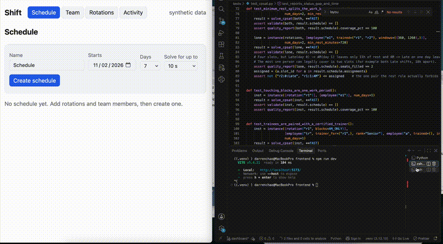

# Shift

[](https://github.com/tsundarren/shift/actions/workflows/ci.yml)

A scheduling engine that assigns staff to rotations (tasks or stations) across a week or two,
respecting hard rules, optimizing soft goals, and explaining its decisions.

**All data is synthetic.** This is a reimplementation inspired by an internal scheduling tool I built at work.

**Status:** Milestone 4 of 4 in progress: the scheduling engine, explanations, overrides, API, and dashboard work end to
end. Deployment is on the [Roadmap](#roadmap).

## Demo



## The model

- **Rotations** are the base: user-created tasks, each split into **blocks** (e.g. AM and PM) with their own headcount.
  A block on a given day is a **slot**, the unit that gets staffed.
- **Employees** have a list of trained rotations (the checkboxes), a free-text **rank**, a hex **color**, availability
  windows by weekday (so part-day staff can cover some blocks but not others), approved days off, and preferred days off.
- **Trainees:** an employee can be assigned to a rotation they're still learning, paired with a certified trainer who is
  working the same slot: "John (trained by Jane)".
- A rotation that needs three people gets three assignments, which is how a part-day employee's AM block and a colleague's
  PM block add up to full coverage.

## Quickstart

```bash
python -m venv .venv
source .venv/bin/activate
pip install -r requirements-dev.txt
pytest -v

# Greedy baseline
python -m scripts.demo --seed 3 --tightness 0.7 --days 7

# CP-SAT solver
python -m scripts.demo --seed 3 --tightness 1.2 --algo cpsat

# Benchmark (--quick for a short run)
python -m scripts.benchmark --quick
```

Requires Python 3.10+ (3.12 recommended). The API tests need Postgres (see [Running the API](#running-the-api)); without it
they are skipped with a message.

## Project layout

```
scheduler/       pure Python: no web or database code
  models.py      rotations, blocks, slots, employees, assignments, eligibility
  validate.py    independent hard-rule checker
  generate.py    synthetic instance generator
  greedy.py      baseline algorithm
  cpsat.py       CP-SAT model and solver
  objective.py   the objective, computed independently of any solver
  overrides.py   pins, bans, and the reasons behind "why not?"
  explain.py     explanations and the manual-revision workflow
  serialize.py   rows <-> domain objects, and the grid and dropdown payloads
  metrics.py     quality report
api/             FastAPI + SQLAlchemy service
  main.py        app and error handlers
  routes.py      HTTP routes (thin)
  service.py     loads data, calls the scheduler, stores results
  models.py      database tables
  schemas.py     request and response shapes
scripts/
  demo.py, benchmark.py, explain_demo.py, seed_db.py
tests/           unit tests, exhaustive model checks, real-solver tests; tests/api needs Postgres
Dockerfile, docker-compose.yml
```

## Design decisions

**Independent validator.** `scheduler/validate.py` is the source of truth for the hard rules and shares no code with
the greedy baseline or the solver, so a modeling bug can't hide itself. Every schedule from any algorithm must pass it.

**Small dependency surface.** The `scheduler` package is plain Python with no web or database dependencies. OR-Tools is
imported only when the solver actually runs.

**Synthetic instances with a tightness dial.** `generate_instance(seed, tightness=...)` sizes the workforce relative
to demand so algorithms can be compared on easy and hard problems across many seeds.

## The solver

`scheduler/cpsat.py` builds a CP-SAT model with one yes/no variable per eligible (employee, slot) pair. Unqualified and
unavailable pairs are never created, which keeps the model small. For a trained employee the variable means "works
the slot"; for someone still learning the rotation it means "attends as a trainee", and a pairing variable picks the
trainer.

**Hard constraints:** no double-booking, daily and weekly hour caps, minimum rest between work periods (touching
blocks count as one period), trainee limits per slot and per trainer, and a trainer who is actually working the slot.

**Coverage is soft.** Every slot has a shortage variable with a large penalty, so an impossible instance returns the
best partial schedule plus a shortfall report instead of "infeasible".

**Objective** (`scheduler/objective.py`, lower is better), all in minutes:
coverage x missing worker-minutes + fairness x |minutes worked - ideal| + preference x minutes worked on a preferred day
off - training x trainee minutes. "Ideal" is each person's share of total demand, proportional to their target hours.
The weights are judgment calls, not measured facts.

## Explanations and manual overrides

**Overrides.** A manager can *pin* an assignment ("Sam works Tuesday AM no matter what") or *ban* one ("not Jane on
Friday"). `apply_overrides` re-solves with a **stability** term in the objective: every assignment added or removed
relative to the current schedule costs a few points per minute, so the result is the cheapest revision, not a fresh
schedule. Overrides are checked before solving (an ineligible pin, two pins that overlap, a pin and a ban on the same
assignment) and rejected with a reason if they can't coexist.

**Explanations.** `explain_assignment(instance, schedule, employee, slot)` answers in layers:

1. Already assigned: say so.
2. A rule makes it impossible (not trained, approved day off, not available that day or that time): name the rule.
   No solving needed.
3. Otherwise it is possible, so the solver is asked: re-solve with that assignment pinned and report what would move and
   what it would cost against the current schedule, in plain English.

Example from a two-person toy instance (the person is on Monday; why not also Tuesday?):

> Right now R1 AM on Tue (day 1), 07:00-11:00 already has all 1 worker(s): E2. E1 could be scheduled there. Making room
> changes 2 assignment(s): Remove E2 from R1 AM on Tue (day 1), 07:00-11:00; Add E1 to R1 AM on Tue (day 1), 07:00-11:00.
> That is why it isn't done: workloads would end up 8.0 h further from an even split.

Reasons are split into *static* (true however the rest of the schedule is arranged) and *dynamic* (true of the current
schedule only, such as a full slot or a clash with another shift). Dynamic reasons are context, not a final answer,
because rearranging other people could remove them.

```bash
python -m scripts.explain_demo --seed 3 --list                          # questions worth asking
python -m scripts.explain_demo --seed 3 --who e03 --slot r1:1:AM        # why not?
python -m scripts.explain_demo --seed 3 --pin e03:r1:1:AM --ban e05:r2:0:PM
```

**Limits.** The stability weight is a judgment call. An explanation describes the cheapest revision the solver found
(optimal when the solver proves it). It is not a claim about what the manager should do.

## Running the API

```bash
docker compose up -d db                                        # Postgres
python -m scripts.seed_db --seed 3 --employees 14 --reset      # a generated workforce
uvicorn api.main:app --reload                                  # http://localhost:8000/docs
```
```bash
# solve a week starting on the date printed by the seed script
curl -X POST localhost:8000/api/schedules -H 'Content-Type: application/json' \
     -d '{"name": "Week 1", "start_date": "2026-11-02", "num_days": 7}'
```
`pytest` runs the API tests when Postgres is up and skips them (with a message) when it isn't. CI sets `REQUIRE_DB=1`,
so a missing database fails the build instead of skipping.

## API overview

| Endpoint | What it does |
|---|---|
| `GET/POST /api/rotations`, `PUT/DELETE /api/rotations/{id}` | Rotations with blocks, headcount per block, weekdays. `DELETE` archives. |
| `GET/POST /api/employees`, `PUT/DELETE /api/employees/{id}` | Name, free-text rank, hex color, per-rotation level (`training`, `trained`, `trainer`), weekly availability windows, time off. `DELETE` archives. |
| `POST /api/schedules` | Solve a schedule for a start date and number of days. Synchronous: takes up to `time_limit` seconds. |
| `GET /api/schedules/{id}` | The grid data (every slot with who is on it, colors, trainers), quality summary, rule violations, and locks. |
| `GET /api/schedules/{id}/slots/{slot}/candidates` | Everyone, marked `assigned`, `eligible`, or `blocked`, with reasons. Feeds the "who can go here?" dropdown. |
| `POST /api/schedules/{id}/overrides` | Pin or ban assignments; re-solves changing as little as possible and returns the list of changes. |
| `DELETE /api/schedules/{id}/locks/{lock}` | Forget a pin or ban (assignments stay until the next revision). |
| `GET /api/schedules/{id}/explain?employee_id=&slot_id=` | "Why isn't Sam on Tuesday?" in plain English, with what would move and what it would cost. |
| `GET /api/audit` | Append-only record of changes. |

## Design decisions: API and data

**Thin routes, a service layer, and a pure core.** Routes only translate HTTP; `api/service.py` loads data and stores
results; every scheduling decision comes from the `scheduler` package. `scheduler/serialize.py` converts rows to domain
objects and builds the response payloads, so the payload logic is unit-tested without a database.

**Slots are derived, not stored.** A slot id like `r1:3:AM` is a rotation, a day offset from the schedule's start date,
and a block name. Only assignments are stored, so editing a rotation can't leave orphaned slot rows.

**Schedules are checked against the current workforce on every read.** If someone is archived or their availability
changes after a schedule was solved, the schedule is flagged with violations instead of silently looking fine.

**Locks persist.** A manager's pin or ban is stored and respected by every later revision and by explanations; the latest
decision about an assignment wins. Revising holds a row lock on the schedule so two simultaneous revisions can't clobber
each other.

**Archive, never delete.** Employees and rotations are marked inactive so old schedules keep their references.

## How it is verified

- **Independent evaluator.** `schedule_cost` computes the objective in plain Python for any schedule, and a test checks
  that the solver's reported objective equals it.
- **Exhaustive formulation tests.** The model-building code is parameterized by the modeling API. `tests/fake_cp.py` is a
  tiny stand-in that tries every 0/1 assignment; for tiny instances the model's optimum is compared with a brute-force
  search that uses only the validator and the evaluator, and every solution the model considers optimal must be valid
  (and must honor any pins and bans). These tests run without OR-Tools.
- **Mutation checks.** I deliberately broke the model and the override, explanation, and serialization code (dropping each
  constraint and objective term, ignoring pins and bans, flipping signs, and so on) and confirmed the tests fail each time.
- **Explanations** are tested end to end with an exhaustive stand-in solver, so they run without OR-Tools.
- **Real-solver and API tests** (`tests/test_cpsat.py`, `tests/test_explain_cpsat.py`, `tests/api/`) check the OR-Tools
  and database integration on realistic instances.

These tests verify that the model implements the intended constraints and objective, not the correctness of OR-Tools itself.

## Benchmark

```bash
python -m scripts.benchmark --seeds 10 --time-limit 10
```

Measured on an Apple M1 Pro (16 GB RAM), OR-Tools 9.15.6755, 8 workers, 10 s limit per instance, 5 rotations, 7 days,
seeds 0-9. Both algorithms are judged by the same validator and the same objective.

| Tightness | Instances | Coverage: greedy | Coverage: CP-SAT | Mean cost: greedy | Mean cost: CP-SAT | CP-SAT better / tied / worse |
|---|---|---|---|---|---|---|
| 0.50 | 10 | 100.0% | 100.0% | 16,766 | 2,349 | 10 / 0 / 0 |
| 0.70 | 10 | 99.6% | 99.7% | 23,550 | 13,201 | 10 / 0 / 0 |
| 1.00 | 10 | 93.3% | 94.8% | 179,688 | 143,333 | 10 / 0 / 0 |
| 1.30 | 10 | 79.4% | 80.2% | 497,775 | 481,239 | 7 / 3 / 0 |

| Tightness | CP-SAT proven optimal | CP-SAT mean time | Greedy mean time | Valid: greedy | Valid: CP-SAT |
|---|---|---|---|---|---|
| 0.50 | 100% | 0.10s | 11ms | 100% | 100% |
| 0.70 | 100% | 0.07s | 9ms | 100% | 100% |
| 1.00 | 100% | 0.04s | 8ms | 100% | 100% |
| 1.30 | 100% | 0.03s | 6ms | 100% | 100% |

Mean cost by component (lower is better; training is a reward, so more negative is better):

| Tightness | Coverage: greedy | Coverage: CP-SAT | Fairness: greedy | Fairness: CP-SAT | Preference: greedy | Preference: CP-SAT | Training: greedy | Training: CP-SAT |
|---|---|---|---|---|---|---|---|---|
| 0.50 | 0 | 0 | 14,558 | 3,573 | 5,040 | 0 | -2,832 | -1,224 |
| 0.70 | 9,600 | 7,200 | 8,886 | 3,889 | 6,600 | 2,280 | -1,536 | -168 |
| 1.00 | 156,000 | 120,000 | 6,000 | 5,045 | 17,880 | 18,360 | -192 | -72 |
| 1.30 | 470,400 | 453,600 | 9,639 | 9,303 | 17,760 | 18,360 | -24 | -24 |

**What the numbers show.** CP-SAT was never worse than greedy on the objective: it was better on 37 of 40 instances and
tied on 3 (all at tightness 1.30), and every schedule from both algorithms passed the validator. The component table shows
where the gap comes from. At tightness 0.50 both fill every seat, so the whole gap (16,766 vs 2,349) is soft goals:
fairness accounts for about 76% of it and preferences about 35%, while training works the other way (about -11%): greedy
gives trainees more hours than CP-SAT does. A likely reason is that the solver weighs balanced workloads above trainee
time at the current weights; I haven't tested that. As problems tighten, the gain moves to coverage: about 23% of the
gap at 0.70 and 99% at 1.00, where CP-SAT also accepts slightly worse preference outcomes (18,360 vs 17,880) to fill more
seats. At 1.30 both leave roughly 20% of seats empty; I haven't yet isolated whether that is a shortage of qualified,
available staff or the scheduling rules. CP-SAT proved optimality on every instance in about 0.1 s or less, so these
instances are easy for it. Because the solver optimizes exactly the cost being compared, coverage and rule validity are
the more independent measures.

## Dashboard

A React + TypeScript (Vite) app over the API.

```bash
docker compose up -d db
python -m scripts.seed_db --seed 3 --employees 14 --reset     # a generated team
uvicorn api.main:app --reload                                  # API on :8000
cd frontend && npm install && npm run dev                      # dashboard on http://localhost:5173
```

- **Team:** each person is a rounded card filled with their color (any hex value, with a live preview). Edit a person's
  name, free-text rank, weekly hours, a level for every rotation (none, learning, trained, trainer), weekly availability
  windows, and time off (approved or preferred).
- **Rotations:** create tasks or stations, pick the weekdays they run, and split the day into blocks with their own
  headcount, so part-day staff can cover some blocks but not others.
- **Schedule:** a grid of rotation blocks by day, with each person drawn as a pill in their color. Trainees have a dashed
  outline and read "John (trained by Jane)". Slots that are short are highlighted.
- **Slot panel:** click any cell to see who is on it, who could be added, and who can't be (with the reason). Put someone
  there, keep someone off, or ask "Why not?" for a plain-English explanation of what would move and what it would cost.
  Manual decisions are listed below the grid and can be unlocked.
- **Activity:** the append-only audit log.

**Design decisions.** Everything that can be wrong without a browser (color contrast, grid layout, form validation, date
handling, error messages) lives in `frontend/src/lib` as plain functions with unit tests; the React components are thin.
Text color on every pill is chosen by WCAG contrast, so any user-picked color stays readable. In development, Vite
proxies `/api` to the API, so there is no CORS setup.

```bash
cd frontend && npm test          # logic tests
npm run typecheck && npm run build
```

## Roadmap

- [x] Domain model, generator, validator, greedy baseline, metrics
- [x] CP-SAT solver with soft coverage and a benchmark against greedy
- [x] Explanations ("why isn't Sam on Tuesday?") and manual overrides with a stability penalty
- [x] FastAPI + PostgreSQL
- [ ] Rule: maximum consecutive working days (validator and solver)
- [X] React dashboard: employee cards (rank color), rotation editor, schedule grid, eligible-staff dropdowns
- [ ] Deployment

## Known limits

- Shifts live within a single day (no overnight blocks yet).
- The greedy baseline can't look ahead or undo choices; that is the point of comparing it with a solver.
- The benchmark instances are small and synthetic, and CP-SAT solves them to optimality almost instantly.
- Solves run inside the request (capped at 30 s), so a busy server would need a job queue.
- There is no authentication or per-user audit identity, so none of this is production-ready.
